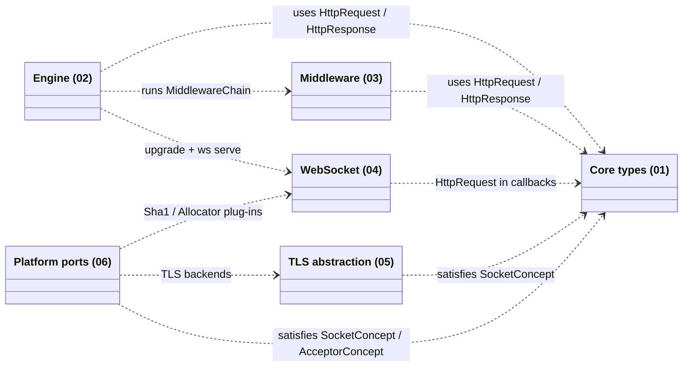

# uchttp — Class Diagrams

Diagramy klas zostały podzielone na mniejsze pliki tematyczne (katalog
[`docs/class_diagram/`](docs/class_diagram/)). Ten plik jest indeksem i zawiera
widok ogólny (zależności między modułami).

| Plik | Zawartość |
|---|---|
| [01_core_types.md](docs/class_diagram/01_core_types.md) | Pojęcia (concepts), `HttpRequest`, `HttpResponse`, `QueryString`, `PathParam`, `Route` |
| [02_engine.md](docs/class_diagram/02_engine.md) | `HttpServer`, `ConnectionPool`, `HttpConnection`, `ParseState`, `RouteTable` |
| [03_middleware.md](docs/class_diagram/03_middleware.md) | `MiddlewareChain`, middleware security (`uchttp::security`) i application (`uchttp::app`) |
| [04_websocket.md](docs/class_diagram/04_websocket.md) | WebSocket (RFC 6455): `Session`, `Handlers`, `Transport`, Sha1/Allocator concepts |
| [05_tls.md](docs/class_diagram/05_tls.md) | `TlsSocket`, `TlsAcceptor`, backendy OpenSSL / wolfSSL |
| [06_platform_ports.md](docs/class_diagram/06_platform_ports.md) | Linux, Zephyr (HTTP/TLS/WS) oraz dublery testowe (`MockSocket`) |

## Widok ogólny modułów

## Uwagi ogólne

- Parametry szablonów są skracane w nazwach klas Mermaid (np. `Socket_RxSize_TxSize` zamiast `Socket, RxSize, TxSize`).
- `SocketConcept`, `AcceptorConcept`, `TlsSessionConcept`, `ws::Sha1Concept`, `ws::AllocatorConcept` to koncepty C++20 — na diagramach pokazane jako interfejsy `<<concept>>`. Brak klas wirtualnych (idiom CRTP / koncepty).
- Wszystkie bufory (`rx_buf_`, `tx_buf_`, sesje WS) i tablice (trasy, middleware, nagłówki, parametry ścieżki, sloty połączeń) są statyczne/stosowe — brak alokacji dynamicznej.
- `HandlerFn`, `StreamHandlerFn`, `MiddlewareFn` to zwykłe wskaźniki na funkcje.
