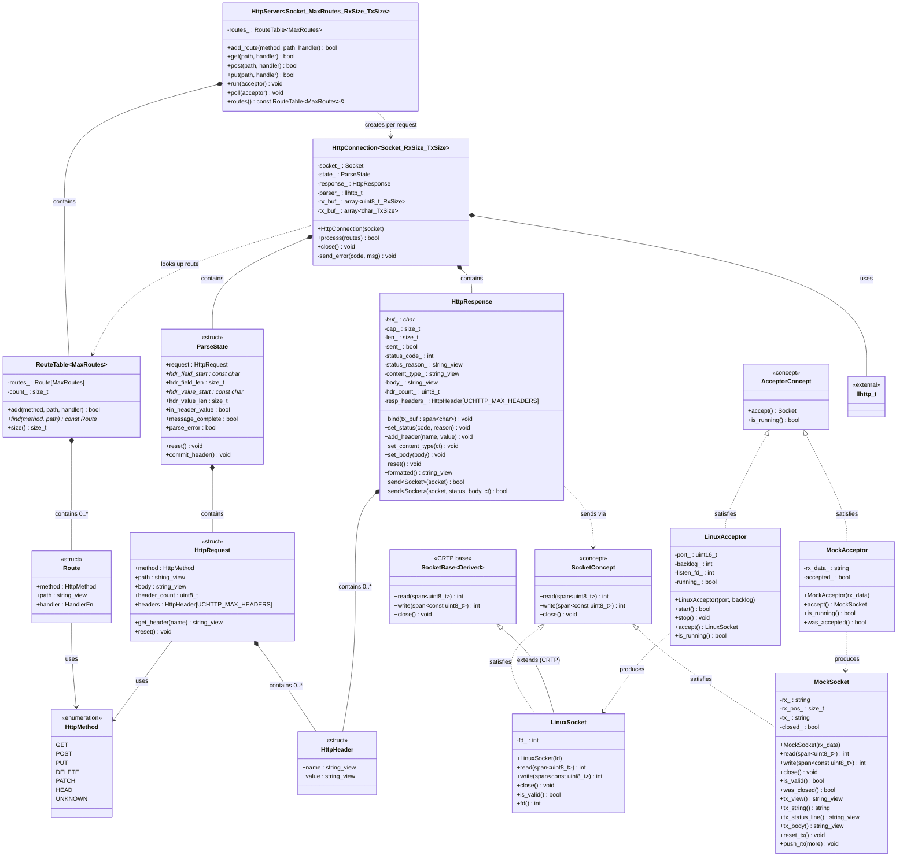

# uchttp — Class Diagram

## Notes

- **Template parameters** are abbreviated in class names where Mermaid would make the name too long (e.g. `Socket_RxSize_TxSize` instead of `Socket, RxSize, TxSize`).
- `SocketConcept` and `AcceptorConcept` are C++20 concepts, shown as interfaces for diagram clarity.
- `SocketBase<Derived>` is an optional CRTP helper; `LinuxSocket` currently inherits from it.
- `HandlerFn` is a plain function pointer `void(*)(const HttpRequest&, HttpResponse&)` and is embedded in `Route` rather than shown as a separate class.
- `llhttp_t` is the opaque parser struct from the third-party llhttp library.
- All buffers (`rx_buf_`, `tx_buf_`) are stack/static — no heap allocation anywhere in the library.
