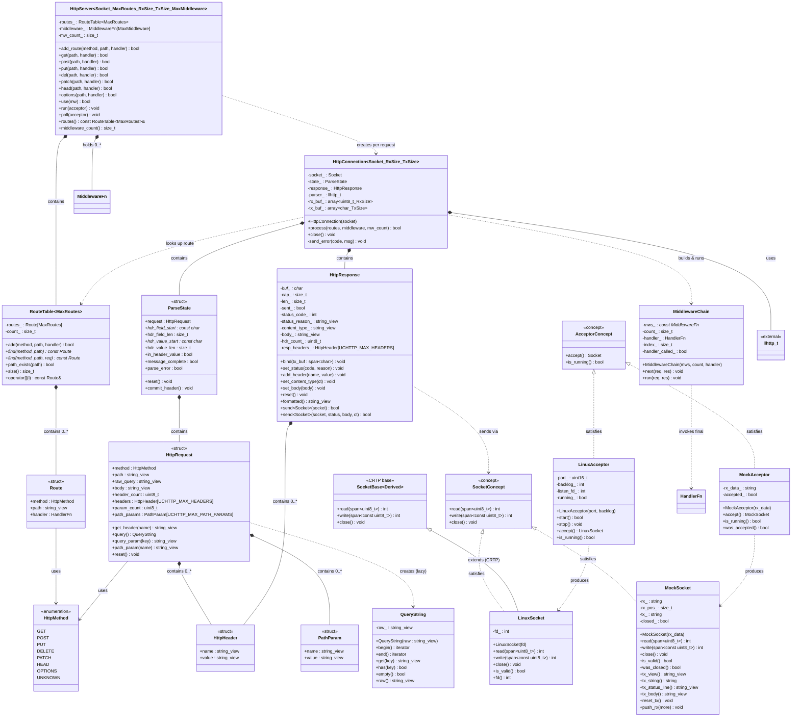

# uchttp — Class Diagram

## Notes

- **Template parameters** are abbreviated in class names where Mermaid would make the name too long (e.g. `Socket_RxSize_TxSize` instead of `Socket, RxSize, TxSize`).
- `SocketConcept` and `AcceptorConcept` are C++20 concepts, shown as interfaces for diagram clarity.
- `SocketBase<Derived>` is an optional CRTP helper; `LinuxSocket` currently inherits from it.
- `HandlerFn` is a plain function pointer `void(*)(const HttpRequest&, HttpResponse&)` and is embedded in `Route` rather than shown as a separate class.
- `MiddlewareFn` is a plain function pointer `void(*)(const HttpRequest&, HttpResponse&, MiddlewareChain&)`. Middleware form a Chain of Responsibility: `MiddlewareChain::next()` advances to the next middleware or invokes the final route handler ("onion" model — code after `next()` runs on the way out). `HttpServer` holds a fixed array of up to `MaxMiddleware` (`UCHTTP_MAX_MIDDLEWARE`) function pointers registered via `use()`.
- `QueryString` is an allocation-free, lazy iterator over `key=value&...` pairs from `HttpRequest::raw_query`; it is created on demand by `HttpRequest::query()` and owns no storage beyond a `string_view`.
- `PathParam` holds a captured `{name}` URL segment as zero-copy `string_view`s into the RX buffer; `RouteTable::find(method, path, req)` fills `HttpRequest::path_params` during pattern matching.
- `llhttp_t` is the opaque parser struct from the third-party llhttp library.
- All buffers (`rx_buf_`, `tx_buf_`) and tables (routes, middleware, headers, path params) are stack/static — no heap allocation anywhere in the library.
