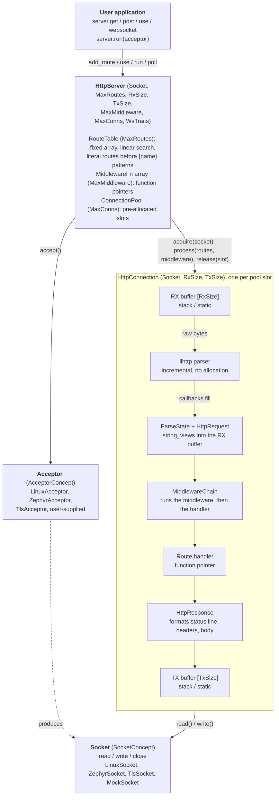
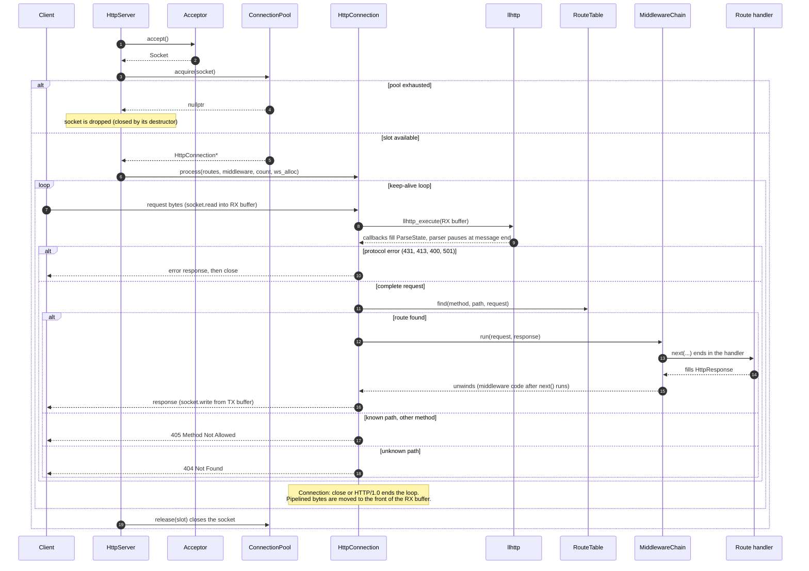
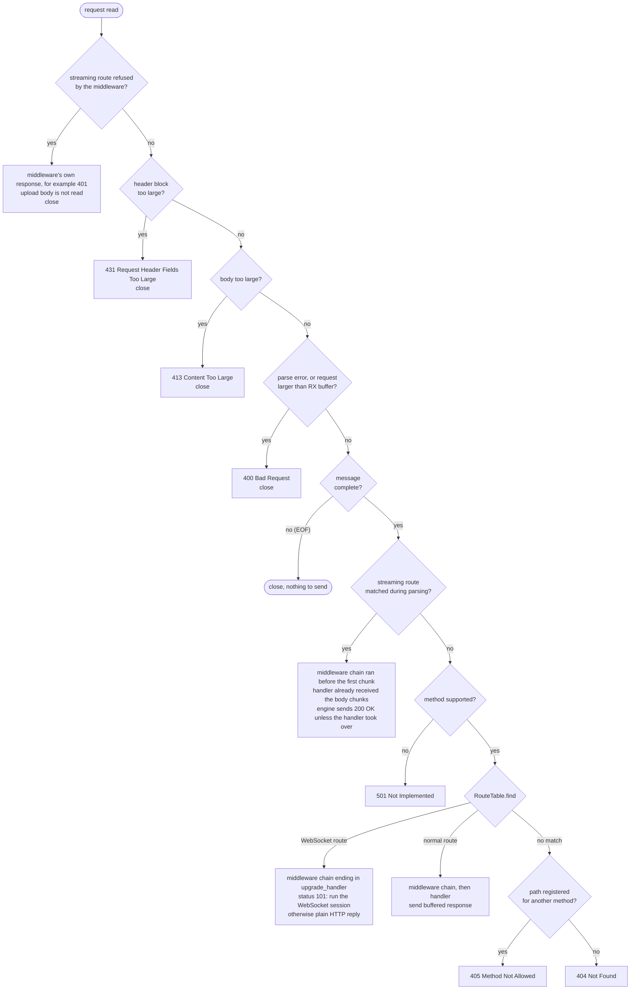
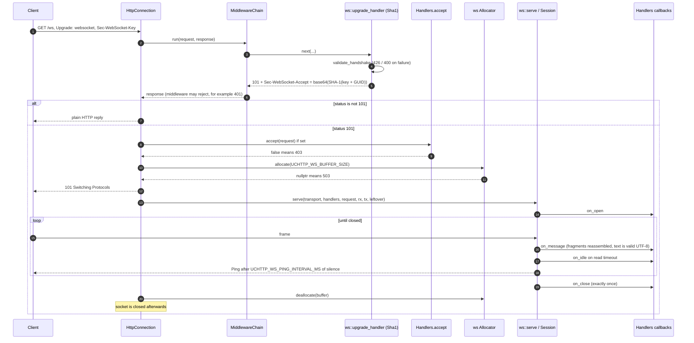
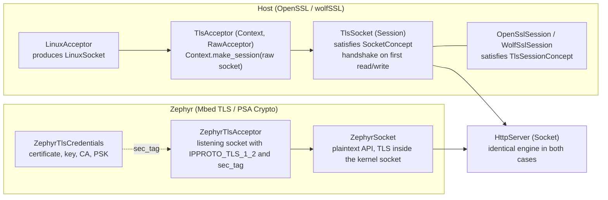

<!-- SPDX-License-Identifier: MIT -->
<!-- Copyright (c) 2026 Cezary Manista -->

# Architecture

uchttp is a C++23 HTTP/1.1 server for small targets. Everything that depends on
the platform (sockets, TLS library, SHA-1, session memory) is a template
parameter that satisfies a C++ concept, so the engine contains no virtual
functions and no heap allocation.

[← Documentation index](../README.md)

Contents:

- [Layers](#layers)
- [Request lifecycle](#request-lifecycle)
- [Request dispatch](#request-dispatch)
- [WebSocket upgrade](#websocket-upgrade)
- [TLS](#tls)
- [Memory model](#memory-model)
- [Concurrency model](#concurrency-model)
- [Compile-time configuration](#compile-time-configuration)
- [Source layout](#source-layout)
- [Class diagrams](#class-diagrams)

## Layers



| Layer | Responsibility | Satisfies / owns |
|---|---|---|
| `HttpServer` | Registers routes and middleware, runs the accept loop, owns the pool. | `RouteTable`, `ConnectionPool`, middleware array, WebSocket allocator |
| Acceptor | Produces one `Socket` per client. Applies the idle read timeout. | `AcceptorConcept` (`accept()`, `is_running()`) |
| `ConnectionPool` | Fixed array of `HttpConnection` slots. A full pool refuses the client. | `HttpConnection` (N slots) |
| `HttpConnection` | Keep-alive loop: read, parse, dispatch, respond. Owns the RX/TX buffers and the parser. | `ParseState`, `HttpResponse`, `llhttp_t` |
| Socket | Byte transport. The only part that talks to the network stack. | `SocketConcept` (`read`, `write`, `close`) |

Design rules the code follows:

- **No virtual functions.** Platform parts are template parameters checked by
  concepts (`SocketConcept`, `AcceptorConcept`, `TlsSessionConcept`,
  `ws::Sha1Concept`, `ws::AllocatorConcept`). Handlers and middleware are plain
  function pointers.
- **No heap.** Buffers, route tables, middleware tables, connection slots and
  WebSocket sessions are fixed-size arrays sized at compile time.
- **Zero-copy.** `HttpRequest` holds `string_view`s into the RX buffer. They stay
  valid until the next request is read on the same connection.
- **Parser.** [llhttp](https://github.com/nodejs/llhttp) v9.4.3 is vendored in
  `third_party/` (see
  [UPSTREAM.md](../../third_party/llhttp/UPSTREAM.md) for its origin).

## Request lifecycle

One client connection from `accept()` to close. The inner loop repeats for every
request on a keep-alive connection.



Keep-alive details:

- The parser is paused at every message boundary, so one `read()` that carries
  the tail of one request and the head of the next never mixes request state.
- `request.keep_alive` comes from `llhttp_should_keep_alive()`. It accounts for
  the HTTP version and the `Connection` header.
- If a request does not fit in the RX buffer, the engine answers `400` and closes
  the connection (see [limits](#compile-time-configuration)).

## Request dispatch

Decision order inside `HttpConnection::process` once a request has been read.



Notes:

- `400`, `413`, `431`, `404`, `405` and `501` are produced by the engine. The
  middleware chain does not run for them, so headers added by middleware (for
  example `security_headers`) are absent from these replies.
- **Streaming routes run the middleware chain before the first body chunk.** The
  streaming handler is called while the body is still being parsed, so the engine
  runs the chain as soon as the headers are complete, with a no-op as its final
  target. If a middleware does not call `next()` (for example `api_key_auth`
  answering `401`), the parser is stopped, no byte of the body reaches the
  handler, and the engine sends the middleware's response and closes the
  connection. See
  [Streaming body / OTA](../usage/iot.md#streaming-body--ota-firmware-upload).
- Literal routes are matched before `{name}` patterns. `path_exists` is what
  separates `405` from `404`.

## WebSocket upgrade

A WebSocket endpoint is an ordinary route. The upgrade request goes through the
middleware chain, so authentication and security headers apply.



The WebSocket core (`uchttp_ws.h`) does not know about sockets, the OS or a
crypto library. `HttpConnection` binds a `ws::Transport` (function pointers and a
context pointer) to the concrete socket. SHA-1 and the session buffer come from
`ws::Traits<Sha1, Allocator>`, the last template parameter of `HttpServer`.

## TLS

TLS is a layer around the socket, so the engine is unchanged. On hosts, a TLS
session wraps an accepted file descriptor. On Zephyr, the secure-socket layer of
the network stack encrypts inside `recv()` / `send()`.



Both certificates and pre-shared keys are supported. TLS 1.2 is the minimum
version. `TlsSocket::set_read_timeout` forwards to the session, so the idle
timeout and the WebSocket idle tick work over TLS as well.

## Memory model

| What | Where | Size |
|---|---|---|
| RX / TX buffers | member arrays of each `HttpConnection` | `RxSize` + `TxSize` per slot |
| Connection slots | array in `ConnectionPool`, inside `HttpServer` | `MaxConns` slots |
| Route table | array in `RouteTable` | `MaxRoutes` entries |
| Middleware table | array of function pointers in `HttpServer` | `MaxMiddleware` entries |
| Request headers / path params | arrays in `HttpRequest` | `UCHTTP_MAX_HEADERS`, `UCHTTP_MAX_PATH_PARAMS` |
| Response scratch | `char[32]` in `HttpResponse` (for run-time header values such as `Sec-WebSocket-Accept`) | 32 bytes |
| WebSocket session buffer | one block from the `ws::Allocator` per session (`StaticAllocator` by default) | `UCHTTP_WS_BUFFER_SIZE` |

The server object itself decides where all of this lives. Declare it `static` (or
as a global) for large configurations so it does not land on a small task stack.
`HttpResponse::add_header` keeps views, not copies: header values must outlive
the response (string literals, statics, or `HttpResponse::scratch()`).

## Concurrency model

`HttpServer::run` serves one connection at a time: accept, acquire a slot,
process until the connection ends, release. To serve N clients at once, run N
`HttpServer` instances (threads or RTOS tasks) that share one acceptor. This also
applies to WebSocket, because a session keeps its connection until it closes. The
samples `samples/linux/ws_server` (4 worker threads) and
`samples/zephyr/ws_server` (`CONFIG_APP_SERVER_THREADS`) do this.

`HttpServer::poll` handles at most one connection per call, for cooperative
schedulers. `stop()` ends the accept loop and `shutdown()` closes every active
slot.

## Compile-time configuration

All limits are macros with `#ifndef` defaults. Set them with `-D` on the compiler
command line or, on Zephyr, with the Kconfig symbols (`CONFIG_UCHTTP_*`).

| Macro | Default | Kconfig | Meaning |
|---|---|---|---|
| `UCHTTP_RX_BUFFER_SIZE` | 1024 | yes | RX buffer per connection slot |
| `UCHTTP_TX_BUFFER_SIZE` | 1024 | yes | TX buffer per connection slot |
| `UCHTTP_MAX_ROUTES` | 16 | yes | Entries in the route table |
| `UCHTTP_MAX_MIDDLEWARE` | 8 | no | Entries in the middleware table |
| `UCHTTP_MAX_CONNECTIONS` | 4 | yes | Slots in the connection pool |
| `UCHTTP_MAX_HEADERS` | 16 | no | Request / response headers kept per message |
| `UCHTTP_MAX_PATH_PARAMS` | 8 | no | `{name}` segments per route |
| `UCHTTP_MAX_HEADER_BYTES` | 2048 | yes | Header block limit, answered with `431` |
| `UCHTTP_MAX_BODY_BYTES` | 4096 | yes | Body limit for normal routes, answered with `413` |
| `UCHTTP_IDLE_TIMEOUT_MS` | 5000 | yes | Idle read timeout, `0` disables it |
| `UCHTTP_WS_MAX_MESSAGE_SIZE` | 1024 | yes | Largest message after reassembly (close `1009`) |
| `UCHTTP_WS_MAX_FRAME_SIZE` | = max message size | yes | Largest single frame, checked from the frame header |
| `UCHTTP_WS_CONTROL_RESERVE` | 144 | no | Space kept free for control frames between fragments |
| `UCHTTP_WS_BUFFER_SIZE` | max message + reserve | no | Session buffer, one allocator block |
| `UCHTTP_WS_MAX_SESSIONS` | 1 | yes | Blocks in the default `StaticAllocator` |
| `UCHTTP_WS_IDLE_INTERVAL_MS` | 1000 | yes | Read timeout used as the session tick (`on_idle`) |
| `UCHTTP_WS_PING_INTERVAL_MS` | 15000 | yes | Silence before a Ping; `0` disables the keep-alive |

The limits interact with the RX buffer. A request is read into the RX buffer in
one piece, so the effective cap is the smaller of the buffer and the macro.
With the default 1 KiB RX buffer, a request larger than the buffer is answered
with `400 Bad Request` before `UCHTTP_MAX_HEADER_BYTES` or
`UCHTTP_MAX_BODY_BYTES` can trigger `431` / `413`. To get those status codes,
make `UCHTTP_RX_BUFFER_SIZE` larger than the limits (the unit tests use an
8 KiB buffer for this). Streaming routes are not limited by
`UCHTTP_MAX_BODY_BYTES`.

## Source layout

```
include/uchttp.h                 Core: concepts, HttpRequest/Response, RouteTable, middleware chain,
                                 HttpConnection, ConnectionPool, HttpServer
include/uchttp_security.h        Auth and security-headers middleware, secure_compare
include/uchttp_app_middleware.h  Cache-Control, ETag, Accept-Encoding, X-Request-ID
include/uchttp_ws.h              WebSocket core: codec, Session, Handlers, Sha1/Allocator concepts
include/uchttp_tls.h             TlsSessionConcept, TlsSocket, TlsAcceptor
include/openssl_tls.h            OpenSSL backend (host)
include/wolfssl_tls.h            wolfSSL backend (embedded)
include/uchttp_version.h.in      Template for the generated uchttp_version.h
src/uchttp.cpp                   Non-template engine code (parser callbacks, request/response helpers)
src/uchttp_security.cpp          Security middleware
src/uchttp_app_middleware.cpp    Application middleware
src/uchttp_ws.cpp                WebSocket codec and SHA-1
src/uchttp_ws_session.cpp        WebSocket session loop
src/uchttp_ws_handshake.cpp      WebSocket handshake validation
src/openssl_tls.cpp              OpenSSL backend
src/wolfssl_tls.cpp              wolfSSL backend
src/port/linux/                  LinuxSocket, LinuxAcceptor
src/port/zephyr/                 ZephyrSocket, ZephyrAcceptor, ZephyrTlsAcceptor, ZephyrTlsCredentials,
                                 ZephyrSlabAllocator, ZephyrPsaSha1
zephyr/                          Zephyr module (module.yml, CMakeLists.txt, Kconfig)
samples/common/                  Demo page and telemetry shared by the WebSocket samples
samples/linux/                   http_server, https_server, ws_server
samples/zephyr/                  http_server, https_server, ws_server
tests/                           MockSocket and the gtest suites (see ../testing.md)
third_party/llhttp/              llhttp v9.4.3 (symlink to the versioned directory)
third_party/llhttp.cmake         Single definition of the llhttp sources, used by both builds
scripts/release.sh               Release helper (see ../RELEASING.md)
CMakeLists.txt                   Host build
```

## Class diagrams

Class diagrams per module, verified against the headers:

| Diagram | Contents |
|---|---|
| [01_core_types.md](class_diagrams/01_core_types.md) | Concepts, `HttpRequest`, `HttpResponse`, `QueryString`, `Route` |
| [02_engine.md](class_diagrams/02_engine.md) | `HttpServer`, `ConnectionPool`, `HttpConnection`, `ParseState`, `RouteTable` |
| [03_middleware.md](class_diagrams/03_middleware.md) | `MiddlewareChain`, `uchttp::security`, `uchttp::app` |
| [04_websocket.md](class_diagrams/04_websocket.md) | `Session`, `Handlers`, `Transport`, SHA-1 and allocator concepts |
| [05_tls.md](class_diagrams/05_tls.md) | `TlsSocket`, `TlsAcceptor`, OpenSSL and wolfSSL backends |
| [06_platform_ports.md](class_diagrams/06_platform_ports.md) | Linux, Zephyr and test doubles |

The [index](class_diagrams/README.md) also has a module dependency overview.
