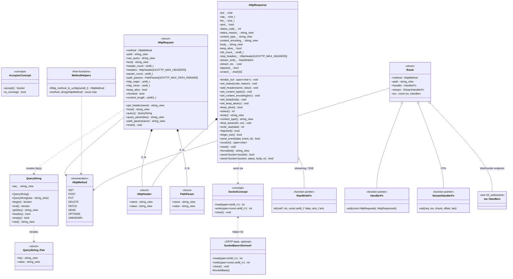

# Core types

Source: `include/uchttp.h`, `src/uchttp.cpp`. [← index](README.md)

## Notes

- `HttpRequest` holds only `string_view`s that point into the RX buffer (zero-copy). The parser fills the protocol metadata (`keep_alive`, `chunked`, `content_length`, `http_major/minor`) in `on_headers_complete`.
- `HttpResponse` only holds views (`add_header` does not copy). Values generated at run time go into `scratch()`.
- A `Route` is one of three kinds: normal (`handler`), streaming/OTA (`stream`) or WebSocket (`ws`). Exactly one of these fields is non-null.
- A streaming handler (`StreamHandlerFn`) receives the body in consecutive chunks as views into the RX buffer. `last == true` marks the final call.
- `write_raw` / `begin_sse` / `send_event` "hijack" the response (`hijacked()`), so the engine does not send its own buffered reply.
- `SocketBase<Derived>` is an optional CRTP helper (its methods forward to `read_impl` / `write_impl` / `close_impl` of the derived class). None of the bundled ports uses it. `SocketConcept` is satisfied directly.
- `QueryString::Pair` is a nested type (`key`, `value`). The iterator is forward-only and does not allocate.
- `UCHTTP_MAX_HEADERS` (default 16) and `UCHTTP_MAX_PATH_PARAMS` (default 8) set the array sizes in `HttpRequest` / `HttpResponse`. The full list of configuration macros is in [../README.md](../README.md#compile-time-configuration).
