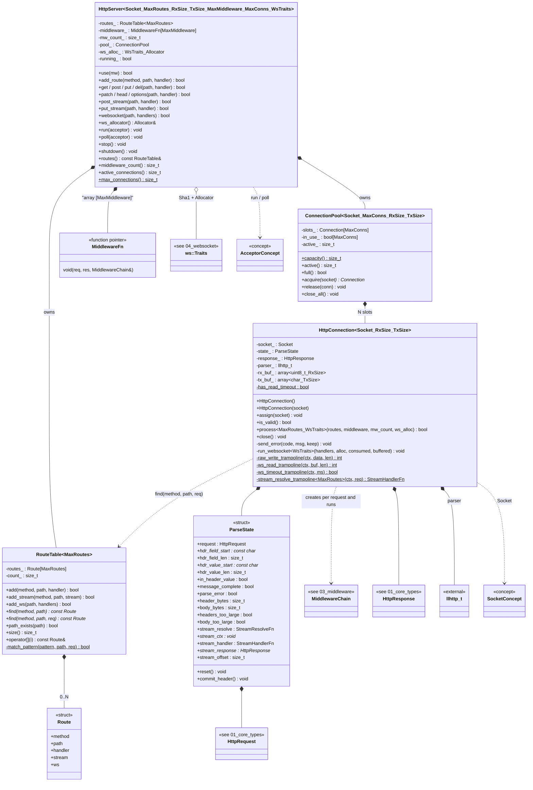

# Engine: server, connections, routing

Source: `include/uchttp.h`, `src/uchttp.cpp`. [← index](README.md)

## `HttpConnection::process` flow

1. `llhttp_reset`, then the streaming-route resolver (`stream_resolve`) is wired in.
2. Keep-alive loop: `state_.reset()`, then read + `llhttp_execute` until `message_complete`. The parser is paused at the message boundary and the rest of the buffer is moved to the front.
3. Protocol errors are generated by the engine before any middleware or handler: `431` (headers too large), `413` (body too large), `400` (syntax error, or a request larger than the RX buffer). Each of them closes the connection.
4. Dispatch:
   - streaming route: the handler has already received the chunks from `on_body` during parsing. The engine sends `200 OK` if the handler did not take over the response. **The middleware chain is not run** for streaming routes (authentication must be done inside the handler),
   - unsupported method (`HttpMethod::UNKNOWN`): `501`, no middleware,
   - WebSocket route: `MiddlewareChain` ends in `ws::upgrade_handler<Sha1>`. On `101` the flow continues with `run_websocket` and `ws::serve`. Otherwise a plain HTTP reply is sent (for example `401` from a middleware, `426`, `400`),
   - normal route: `MiddlewareChain`, then the handler, then `response_.send(socket_)`,
   - no matching route: `405` (the path exists for another method) or `404`. Both are generated by the engine, without middleware.
5. `Connection: close` (or HTTP/1.0 without keep-alive) ends the loop.

## Notes

- `HttpServer` serves one connection at a time (`run` = accept, `pool_.acquire`, `process`, `release`). When the pool is exhausted the connection is refused. To serve N clients in parallel, run N instances (threads) that share one acceptor.
- `RouteTable::find(method, path, req)` looks for a literal match first, then for `{name}` patterns (which fill `req.path_params`).
- `path_exists` is what separates `404` from `405`.
- `shutdown()` = `ConnectionPool::close_all()` (graceful shutdown).
