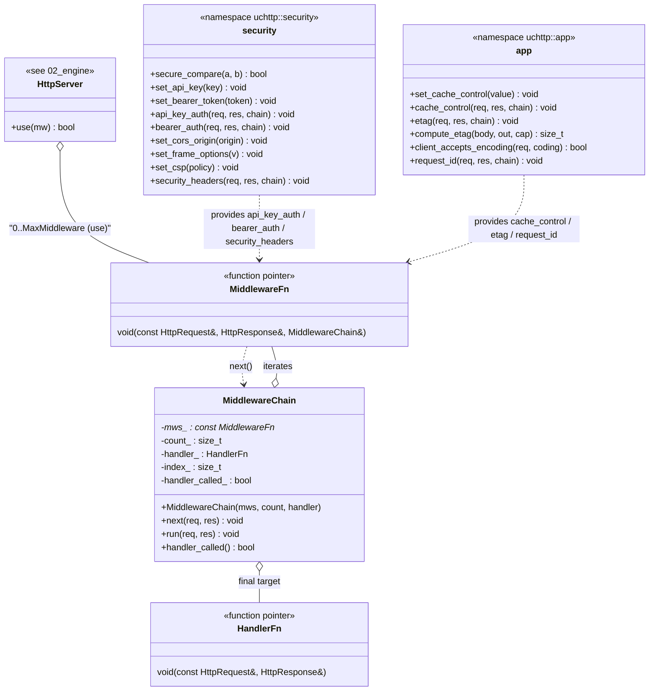

# Middleware

Source: `include/uchttp.h`, `include/uchttp_security.h`, `include/uchttp_app_middleware.h`.
[← index](README.md)

## Notes

- Onion model: code after `chain.next(req, res)` runs on the way back out (security headers, ETag, timing, logging). A middleware that does not call `next()` ends the chain (for example with `401`).
- Middleware run in registration order: `A → B → handler → B → A`. The table has a fixed size, `UCHTTP_MAX_MIDDLEWARE` (default 8).
- A WebSocket upgrade request also goes through the chain (auth, security headers). The final "handler" is `ws::upgrade_handler<Sha1>`.
- Streaming routes (`post_stream` / `put_stream`) go through the chain too, but at a different moment: the engine runs it at `on_headers_complete`, before the first body chunk, with a no-op as the final target. `MiddlewareChain::handler_called()` tells the engine whether the chain reached that target. If a middleware ended the chain early (for example `api_key_auth` answering `401`), the handler is never called, the engine sends the middleware's response and closes the connection. Code after `chain.next()` therefore runs before the body is streamed, so a middleware that reads the response body (such as `etag`) sees it empty.
- `404`, `405`, `501` and protocol errors (`400`, `413`, `431`) are generated by the engine without running middleware, so headers added by middleware (for example `security_headers`) are absent from those replies.
- `uchttp::security`: `api_key_auth` and `bearer_auth` *fail closed* (no configuration means rejection) and compare in constant time with `secure_compare`.
- `uchttp::app::etag`: FNV-1a of the body. A matching `If-None-Match` gives `304` with an empty body.
- The engine's own headers (Host, Content-Length, Transfer-Encoding, Connection) do not belong to middleware.
