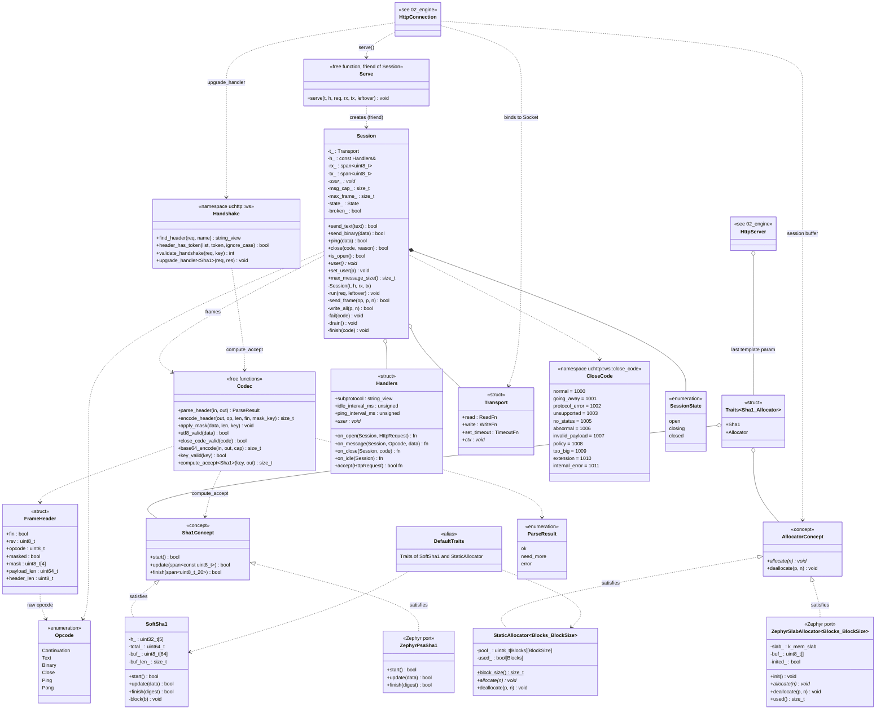

# WebSocket (RFC 6455)

Source: `include/uchttp_ws.h`, `include/uchttp.h` (handshake),
`src/uchttp_ws*.cpp`, `src/port/zephyr/zephyr_ws.h`, `src/port/zephyr/zephyr_psa_sha1.h`.
[← index](README.md)

## Notes

- The WebSocket core (`uchttp_ws.h`) knows nothing about sockets, the OS or a crypto library. Everything is injected: SHA-1 (`Sha1Concept`), session memory (`AllocatorConcept`) and the transport (`Transport`: function pointers plus a context, bound by `HttpConnection`).
- A WebSocket endpoint is an ordinary route (`HttpServer::websocket`). After the `101` reply, `HttpConnection` takes a buffer from the allocator (no memory means `503`), calls the optional `Handlers::accept` (refusal means `403`) and runs `ws::serve`.
- `Session` has a private constructor. Only `ws::serve` (a friend) creates it.
- Transport: `ReadFn` returns `>0` bytes, `0` when the peer closed, `<0` on timeout or error. `set_timeout` is optional (set only when the `Socket` has `set_read_timeout`).
- `UCHTTP_WS_CONTROL_RESERVE` (144 B) keeps room in the session buffer for a control frame between the fragments of a message. `UCHTTP_WS_BUFFER_SIZE` = `UCHTTP_WS_MAX_MESSAGE_SIZE` + that reserve.
- Limits: `UCHTTP_WS_MAX_FRAME_SIZE` (checked from the frame header alone) and `UCHTTP_WS_MAX_MESSAGE_SIZE` (after reassembly, close code `1009`). A keep-alive Ping is sent after `UCHTTP_WS_PING_INTERVAL_MS`.
- `on_idle` is called every time the read timeout expires (`idle_interval_ms`), which gives periodic push without an extra thread.
- The Zephyr components (`ZephyrPsaSha1`, `ZephyrSlabAllocator`) are also described in [06_platform_ports.md](06_platform_ports.md).
