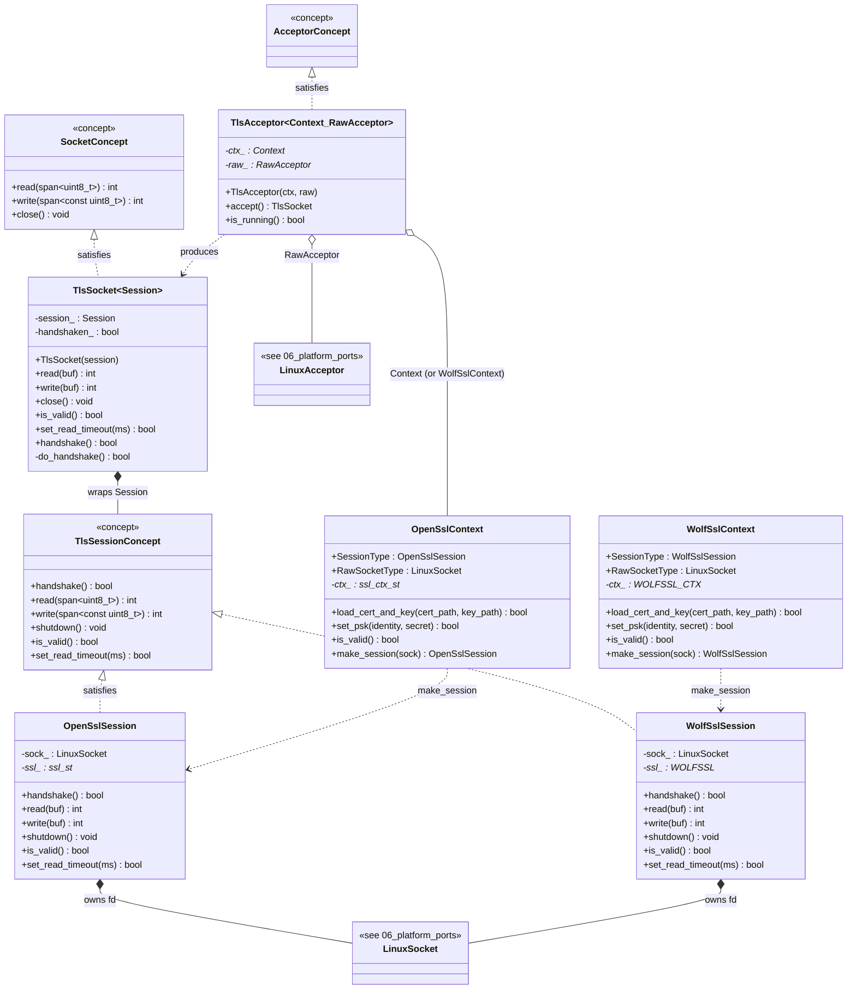

# TLS / HTTPS

Source: `include/uchttp_tls.h`, `include/openssl_tls.h`, `include/wolfssl_tls.h`.
TLS on Zephyr (at the socket level) is described in [06_platform_ports.md](06_platform_ports.md).
[← index](README.md)

## Notes

- The crypto library is replaceable behind `TlsSessionConcept`. `TlsSocket<Session>` satisfies `SocketConcept`, so `HttpServer<TlsSocket<...>>` works without any engine change (including SSE and WebSocket).
- The TLS handshake runs lazily on the first `read` / `write`, or explicitly through `handshake()`.
- `TlsSocket::set_read_timeout` carries Slowloris protection over to TLS connections. `HttpConnection` also uses it for the WebSocket timeout (detected with `requires`).
- The OpenSSL backend is built whenever OpenSSL is available. The wolfSSL backend is built when `UCHTTP_WITH_WOLFSSL=ON`.
- The OpenSSL and wolfSSL types are only forward-declared in the headers, so `<openssl/*>` does not leak into the public API.
- A `Context` must provide `SessionType`, `RawSocketType` and `make_session(RawSocket&&)`.
