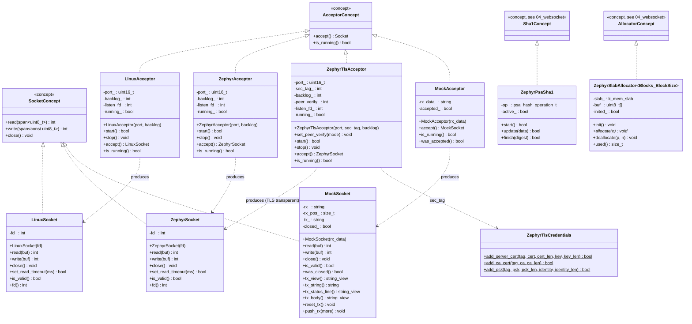

# Platform ports and test doubles

Source: `src/port/linux/linux_socket.h`, `src/port/zephyr/zephyr_*.h`, `tests/mock_socket.h`.
[← index](README.md)

## Notes

- **Linux** (`LinuxSocket`, `LinuxAcceptor`): POSIX `recv` / `send`, with `SO_RCVTIMEO` as the idle timeout (`UCHTTP_IDLE_TIMEOUT_MS`). Used for tests on a host. It is also the transport of the OpenSSL and wolfSSL backends (see [05_tls.md](05_tls.md)).
- **Zephyr** (`ZephyrSocket`, `ZephyrAcceptor`): the native `zsock_*` / `net_*` API. The core (`uchttp.h`) is unchanged, only the port differs.
- **Zephyr TLS**: TLS (Mbed TLS / PSA Crypto) works transparently at the socket level (`IPPROTO_TLS_1_2` + `sec_tag`), so there is no separate session type. `ZephyrTlsAcceptor` returns a plain `ZephyrSocket`. `ZephyrTlsCredentials` registers the certificate and key, a CA, or a PSK. Keep the buffers alive, because the credential store does not copy them.
- **Zephyr WebSocket**: `ZephyrPsaSha1` (PSA Crypto, hardware acceleration where the PSA driver supports SHA-1) and `ZephyrSlabAllocator` (`k_mem_slab`) are plugged in through `ws::Traits`.
- **Porting to another RTOS**: you need your own `Socket` (`read`, `write`, `close`, `is_valid`, optionally `set_read_timeout`) and `Acceptor` (`accept`, `is_running`).
- **Tests**: `MockSocket` / `MockAcceptor` (`namespace uchttp_test`) are in-memory buffers. `MockAcceptor` serves exactly one connection.
