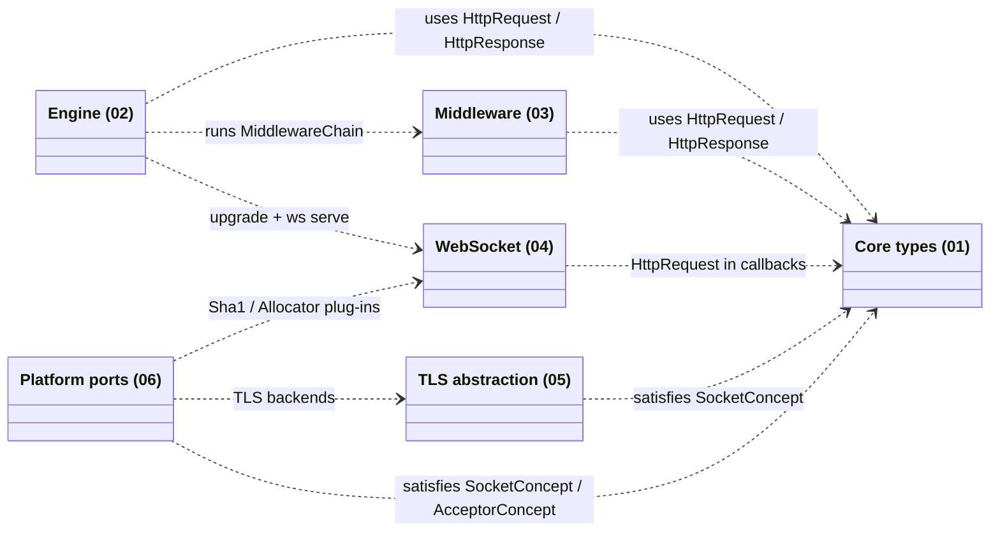

# uchttp — Class Diagrams

The class diagrams are split into smaller files by topic. This file is the index
and contains the module overview (dependencies between modules). For the
architecture description, request lifecycle and configuration, see
[../README.md](../README.md).

| File | Contents |
|---|---|
| [01_core_types.md](01_core_types.md) | Concepts, `HttpRequest`, `HttpResponse`, `QueryString`, `PathParam`, `Route` |
| [02_engine.md](02_engine.md) | `HttpServer`, `ConnectionPool`, `HttpConnection`, `ParseState`, `RouteTable` |
| [03_middleware.md](03_middleware.md) | `MiddlewareChain`, security middleware (`uchttp::security`) and application middleware (`uchttp::app`) |
| [04_websocket.md](04_websocket.md) | WebSocket (RFC 6455): `Session`, `Handlers`, `Transport`, Sha1/Allocator concepts |
| [05_tls.md](05_tls.md) | `TlsSocket`, `TlsAcceptor`, OpenSSL / wolfSSL backends |
| [06_platform_ports.md](06_platform_ports.md) | Linux, Zephyr (HTTP/TLS/WS) and the test doubles (`MockSocket`) |

## Module overview

## General notes

- Template parameters are shortened in the Mermaid class names (for example `Socket_RxSize_TxSize` instead of `Socket, RxSize, TxSize`).
- `SocketConcept`, `AcceptorConcept`, `TlsSessionConcept`, `ws::Sha1Concept` and `ws::AllocatorConcept` are C++20 concepts. The diagrams show them as `<<concept>>` interfaces. There are no virtual classes (concepts and the optional CRTP helper are used instead).
- All buffers (`rx_buf_`, `tx_buf_`, WebSocket sessions) and tables (routes, middleware, headers, path parameters, connection slots) are static or on the stack. There is no dynamic allocation.
- `HandlerFn`, `StreamHandlerFn` and `MiddlewareFn` are plain function pointers.
