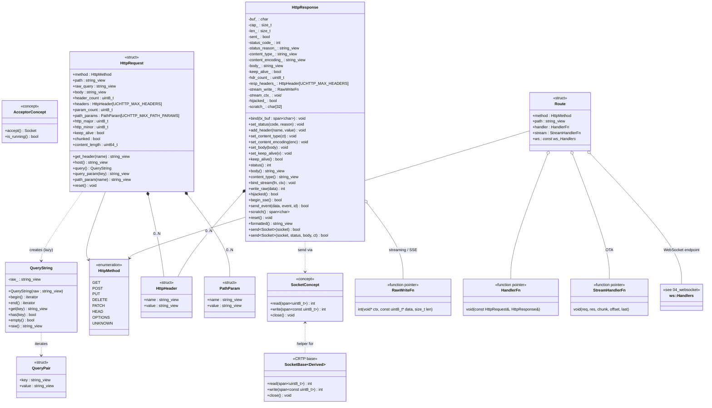

# Core types

Źródło: `include/uchttp.h`, `src/uchttp.cpp`. [← indeks](../../class_diagram.md)

## Uwagi

- `HttpRequest` zawiera wyłącznie `string_view` wskazujące w bufor RX (zero-copy). Metadane protokołu (`keep_alive`, `chunked`, `content_length`, `http_major/minor`) wypełnia parser w `on_headers_complete`.
- `HttpResponse` tylko trzyma widoki (`add_header` nie kopiuje) — wartości generowane w czasie działania trafiają do `scratch()`.
- `Route` ma trzy rodzaje: zwykły (`handler`), strumieniowy/OTA (`stream`) lub WebSocket (`ws`); dokładnie jedno pole jest niepuste.
- Handler strumieniowy (`StreamHandlerFn`) dostaje kolejne kawałki body jako widoki w bufor RX; `last == true` przy ostatnim.
- `write_raw` / `begin_sse` / `send_event` "przejmują" odpowiedź (`hijacked()`), więc silnik nie wysyła już własnej, buforowanej.
- `SocketBase<Derived>` to opcjonalny helper CRTP; `SocketConcept` jest spełniany także bez niego.
