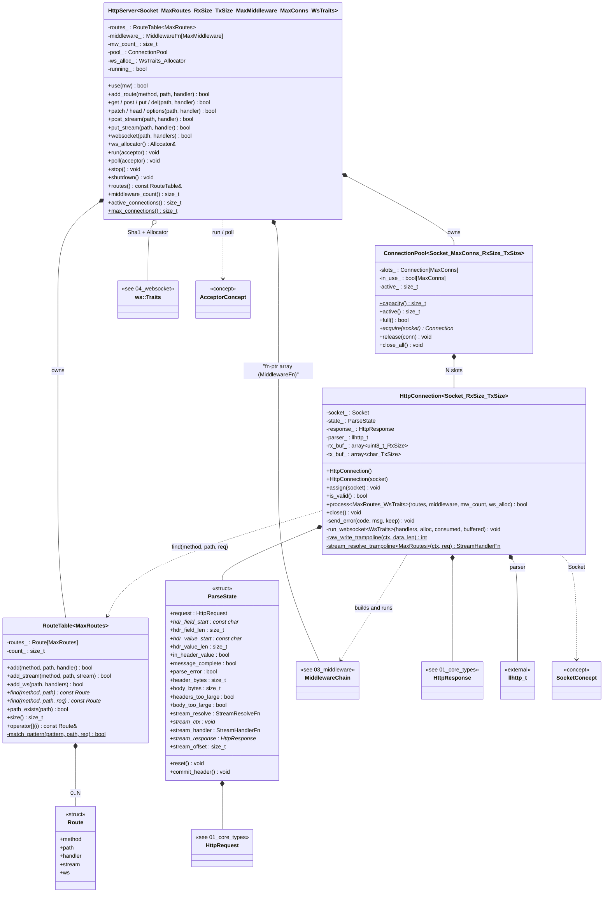

# Engine: server, connections, routing

Źródło: `include/uchttp.h`, `src/uchttp.cpp`. [← indeks](../../class_diagram.md)

## Przebieg `HttpConnection::process`

1. `llhttp_reset`, podpięcie resolvera tras strumieniowych (`stream_resolve`).
2. Pętla keep-alive: `state_.reset()` → odczyt + `llhttp_execute` aż do `message_complete` (parser pauzowany na granicy wiadomości, reszta bufora przesuwana na początek).
3. Błędy protokołu generowane przez silnik przed middleware: `431` (nagłówki), `413` (body), `400` (składnia), `501` (nieobsługiwana metoda), `405`, `404`.
4. Dispatch:
   - trasa strumieniowa — handler dostał już chunki z `on_body`; silnik wysyła `200 OK`, jeśli handler nie przejął odpowiedzi,
   - trasa WebSocket — `MiddlewareChain` kończy się na `ws::upgrade_handler<Sha1>`; przy `101` → `run_websocket` → `ws::serve`,
   - zwykła trasa — `MiddlewareChain` → handler → `response_.send(socket_)`.
5. `Connection: close` (lub HTTP/1.0 bez keep-alive) kończy pętlę.

## Uwagi

- `HttpServer` obsługuje jedno połączenie naraz (`run` = accept → `pool_.acquire` → `process` → `release`); przy wyczerpaniu puli połączenie jest odrzucane. Dla N równoległych klientów używa się N instancji (wątków) współdzielących acceptor.
- `RouteTable::find(method, path, req)` najpierw szuka dopasowania literalnego, potem wzorców `{name}` (wypełnia `req.path_params`).
- `path_exists` rozróżnia `404` od `405`.
- `shutdown()` = `ConnectionPool::close_all()` (graceful shutdown).
