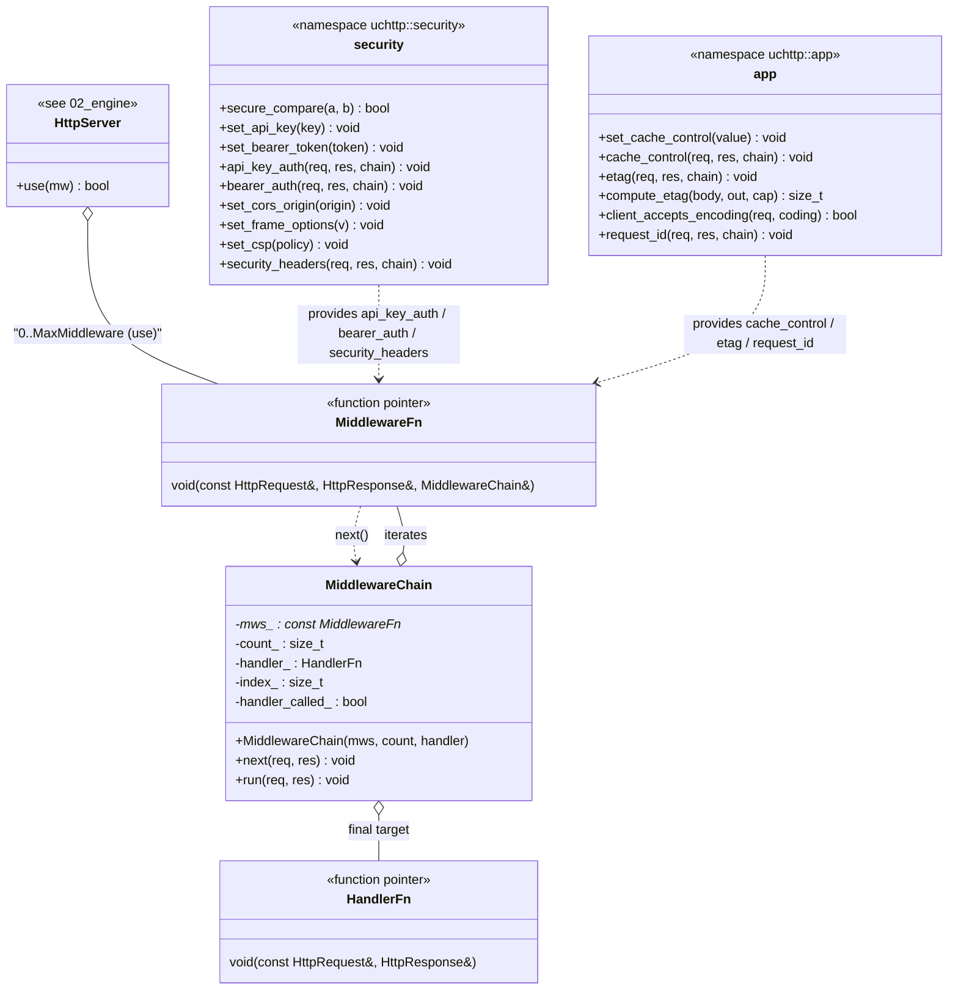

# Middleware

Źródło: `include/uchttp.h`, `include/uchttp_security.h`, `include/uchttp_app_middleware.h`.
[← indeks](../../class_diagram.md)

## Uwagi

- Model "cebuli": kod po `chain.next(req, res)` wykonuje się w drodze powrotnej (nagłówki bezpieczeństwa, ETag, czas, logi). Middleware niewywołujące `next()` przerywa łańcuch (np. `401`).
- Middleware wykonują się w kolejności rejestracji: `A → B → handler → B → A`. Tablica ma stały rozmiar `UCHTTP_MAX_MIDDLEWARE` (domyślnie 8).
- Żądanie WebSocket upgrade również przechodzi przez łańcuch (auth, security headers); końcowym "handlerem" jest `ws::upgrade_handler<Sha1>`.
- `uchttp::security`: `api_key_auth` i `bearer_auth` działają *fail closed* (brak konfiguracji = odrzucenie), porównanie przez `secure_compare` (stały czas).
- `uchttp::app::etag`: FNV-1a z body; zgodny `If-None-Match` → `304` z pustym body.
- Nagłówki własne silnika (Host, Content-Length, Transfer-Encoding, Connection) nie należą do middleware.
