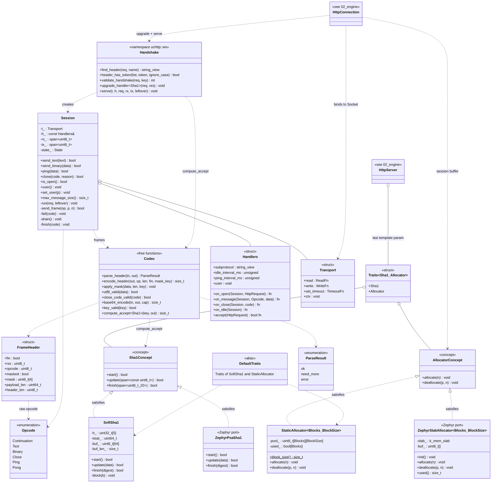

# WebSocket (RFC 6455)

Źródło: `include/uchttp_ws.h`, `include/uchttp.h` (handshake),
`src/uchttp_ws*.cpp`, `src/port/zephyr_ws.h`, `src/port/zephyr_psa_sha1.h`.
[← indeks](../../class_diagram.md)

## Uwagi

- Rdzeń WebSocket (`uchttp_ws.h`) nie zna gniazd, OS ani biblioteki kryptograficznej; wszystko jest wstrzykiwane: SHA-1 (`Sha1Concept`), pamięć sesji (`AllocatorConcept`), transport (`Transport` — wskaźniki na funkcje + kontekst, wiązany przez `HttpConnection`).
- Endpoint WS to zwykła trasa (`HttpServer::websocket`). `HttpConnection` po odpowiedzi `101` pobiera bufor z alokatora (brak pamięci → `503`), wywołuje opcjonalne `Handlers::accept` (odmowa → `403`) i uruchamia `ws::serve`.
- `Session` ma prywatny konstruktor; tworzy go wyłącznie `ws::serve` (friend).
- Limity: `UCHTTP_WS_MAX_FRAME_SIZE` (sprawdzany z samego nagłówka), `UCHTTP_WS_MAX_MESSAGE_SIZE` (po złożeniu fragmentów, close `1009`), keep-alive Ping po `UCHTTP_WS_PING_INTERVAL_MS`.
- `on_idle` jest wołane przy każdym wygaśnięciu timeoutu odczytu (`idle_interval_ms`) — okresowy push bez dodatkowego wątku.
- Komponenty Zephyra (`ZephyrPsaSha1`, `ZephyrSlabAllocator`) opisane także w [06_platform_ports.md](06_platform_ports.md).
