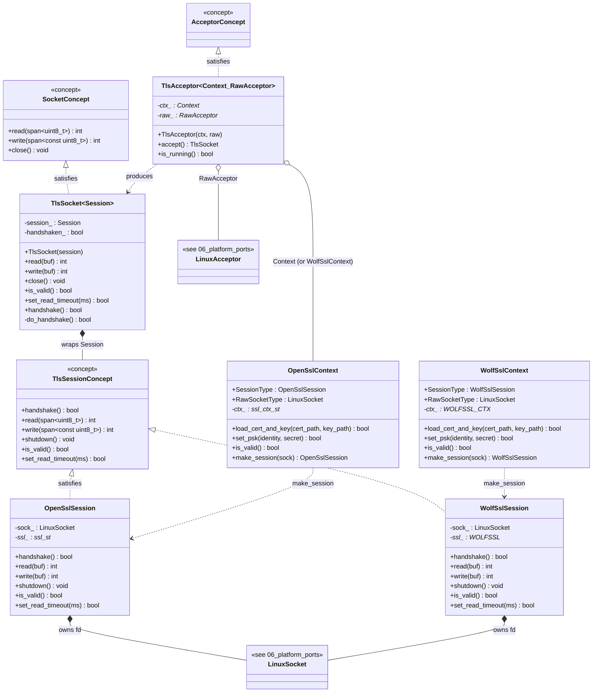

# TLS / HTTPS

Źródło: `include/uchttp_tls.h`, `include/openssl_tls.h`, `include/wolfssl_tls.h`.
Zephyr (TLS na poziomie gniazda) opisany w [06_platform_ports.md](06_platform_ports.md).
[← indeks](../../class_diagram.md)

## Uwagi

- Biblioteka kryptograficzna jest podmienialna za `TlsSessionConcept`; `TlsSocket<Session>` spełnia `SocketConcept`, więc `HttpServer<TlsSocket<...>>` działa bez zmian silnika (w tym SSE i WebSocket).
- Handshake TLS wykonywany jest leniwie przy pierwszym `read`/`write` (lub jawnie przez `handshake()`).
- `TlsSocket::set_read_timeout` przenosi ochronę Slowloris na połączenia TLS; `HttpConnection` używa tego także dla timeoutu WS (wykrywane przez `requires`).
- Backend OpenSSL jest budowany zawsze, gdy OpenSSL jest dostępny; wolfSSL — gdy `UCHTTP_WITH_WOLFSSL=ON`.
- Typy OpenSSL/wolfSSL są tylko zadeklarowane w nagłówkach (forward declaration) — `<openssl/*>` nie wycieka do publicznego API.
- `Context` musi udostępniać `SessionType`, `RawSocketType` i `make_session(RawSocket&&)`.
