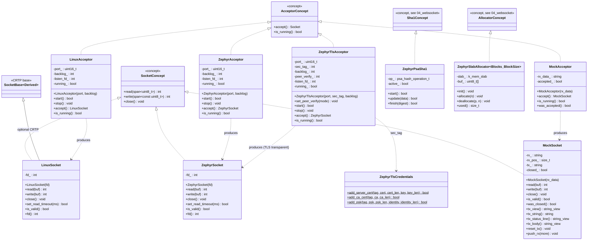

# Platform ports and test doubles

Źródło: `src/linux_socket.h`, `src/port/zephyr_*.h`, `tests/mock_socket.h`.
[← indeks](../../class_diagram.md)

## Uwagi

- **Linux** (`LinuxSocket`, `LinuxAcceptor`): POSIX `recv`/`send`, `SO_RCVTIMEO` jako idle timeout (`UCHTTP_IDLE_TIMEOUT_MS`). Służy do testów na hoście; jest też transportem backendów OpenSSL/wolfSSL (zob. [05_tls.md](05_tls.md)).
- **Zephyr** (`ZephyrSocket`, `ZephyrAcceptor`): natywne API `zsock_*`/`net_*`. Rdzeń (`uchttp.h`) jest niezmieniony — różni się tylko port.
- **Zephyr TLS**: TLS (Mbed TLS / PSA Crypto) działa transparentnie na poziomie gniazda (`IPPROTO_TLS_1_2` + `sec_tag`), więc nie ma osobnej sesji — `ZephyrTlsAcceptor` zwraca zwykły `ZephyrSocket`. `ZephyrTlsCredentials` rejestruje certyfikat/klucz, CA lub PSK; bufory należy trzymać przy życiu (store nie kopiuje).
- **Zephyr WS**: `ZephyrPsaSha1` (PSA Crypto, akceleracja sprzętowa tam gdzie sterownik PSA wspiera SHA-1) i `ZephyrSlabAllocator` (`k_mem_slab`) podłączane przez `ws::Traits`.
- **Porting na inny RTOS**: wystarczy własny `Socket` (`read`, `write`, `close`, `is_valid`, opcjonalnie `set_read_timeout`) i `Acceptor` (`accept`, `is_running`).
- **Testy**: `MockSocket`/`MockAcceptor` (`namespace uchttp_test`) to bufory w pamięci; `MockAcceptor` obsługuje dokładnie jedno połączenie.
